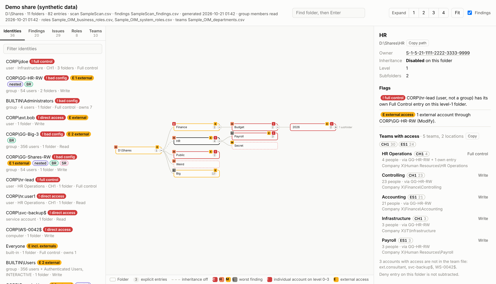
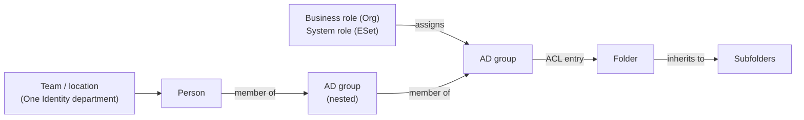
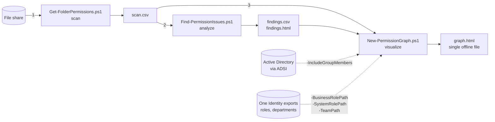
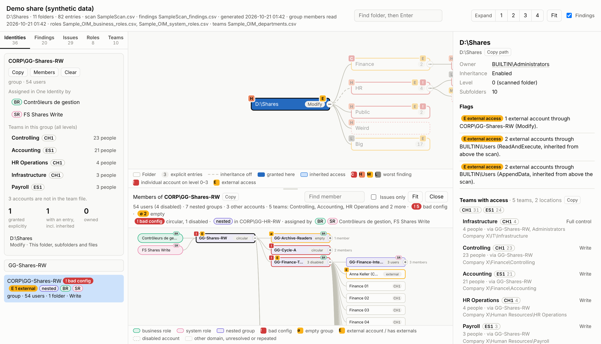
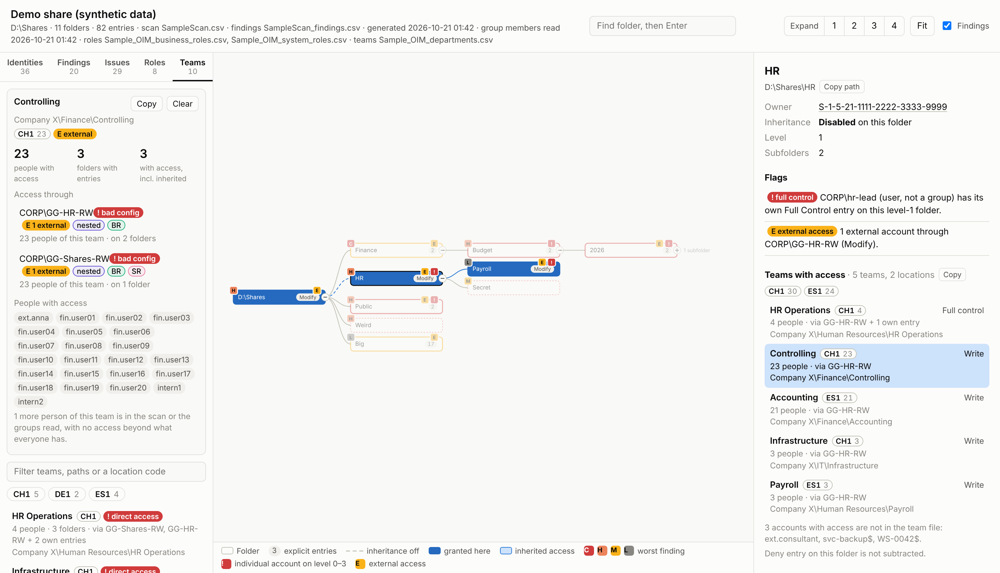
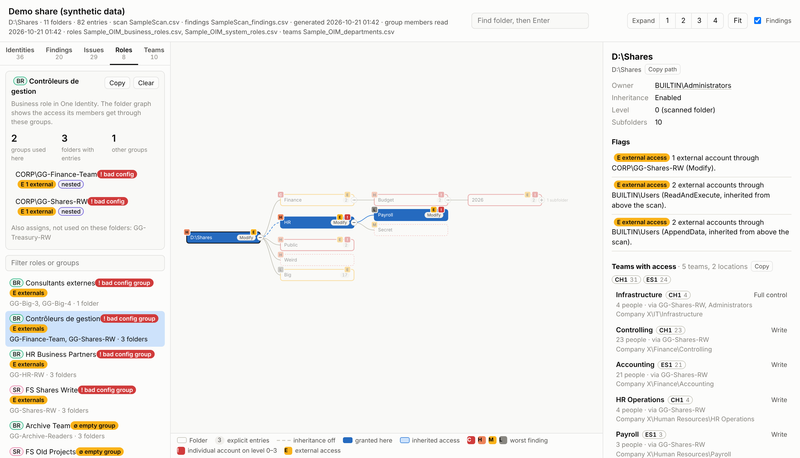
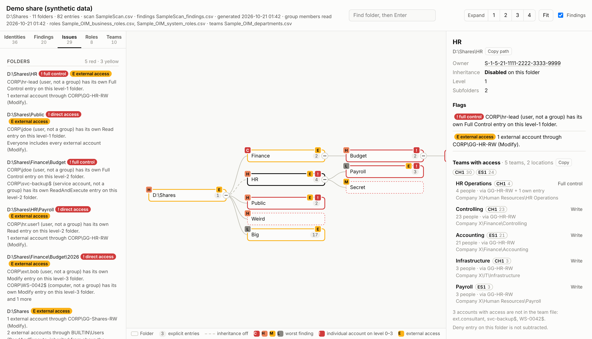
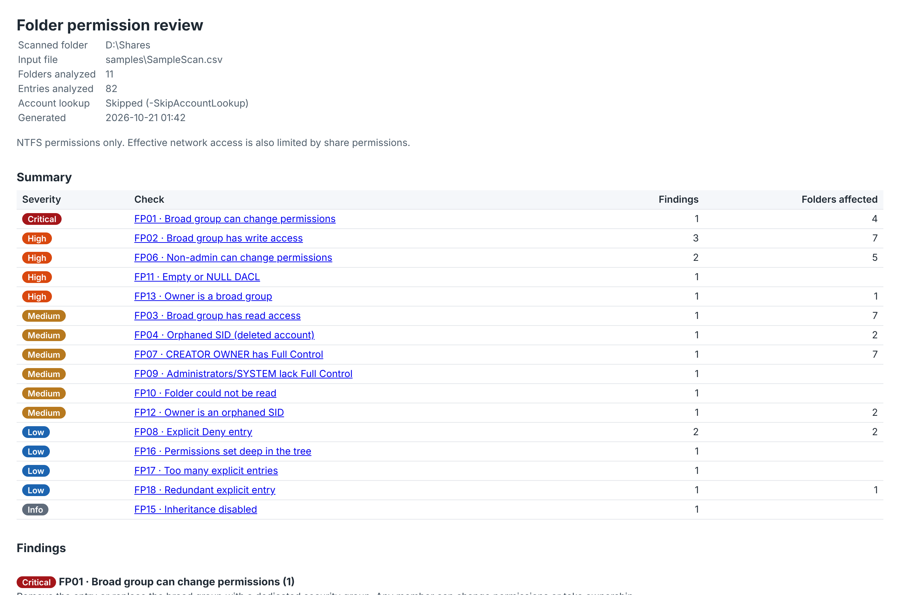
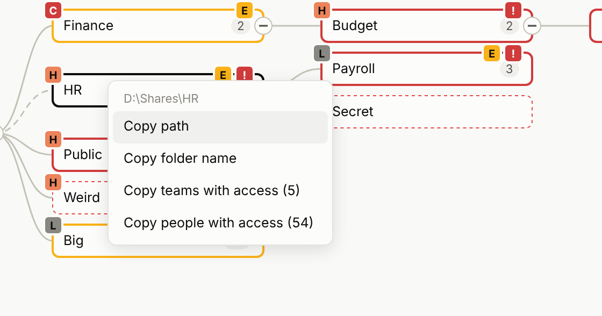

# Folder Permission Visibility

**See who can reach what on a Windows file share, through every nested group, One Identity role and team, in one offline HTML page.**

   



**Live demo (synthetic data):** [open the interactive page](https://zanderzone2030.github.io/IVIP_FileShare/demo/) · [findings report](https://zanderzone2030.github.io/IVIP_FileShare/demo/findings.html)

---

## Why

File shares are where access governance quietly falls apart. Permissions were set years ago, groups are nested inside groups, "temporary" direct grants to users never got removed, and external consultants sit in groups nobody remembers creating.

Each system holds one piece of the answer:

| System | Knows |
|---|---|
| **NTFS** | which group or account has an entry on which folder |
| **Active Directory** | who is in each group, including nested groups and primary-group members |
| **One Identity Manager** | which business role (Org) or system role (ESet) assigns each AD group, and which team (department) and location each person belongs to |

No single tool shows the whole chain, so reviewers end up exporting ACLs to Excel and guessing. This toolkit joins the three into one picture:



Ask any of these questions and get the answer on the page, with the path that explains it:

- Which **teams and locations** (CH1, ES1, ...) can reach this folder, with what rights, and through which group?
- Which folders can **this person**, group, role or team reach, including everything below through inheritance?
- Which **individual accounts** have their own entries instead of going through a group?
- Where do **external accounts** (consultants) get access, directly or hidden in nested groups?
- Which groups are **empty, circular, or contain Domain Users / Everyone**?
- Which **One Identity roles** assign a misconfigured group?

## How it works

Three PowerShell scripts, run in sequence. Each one is useful on its own.



| Step | Script | What it does | Output |
|---|---|---|---|
| 1. Scan | [`Get-FolderPermissions.ps1`](scripts/Get-FolderPermissions.ps1) | Walks the folder tree and records every access entry: owner, rights, Allow or Deny, inherited or explicit, "applies to", broken inheritance, orphaned SIDs, unreadable folders. | One CSV row per entry per folder |
| 2. Analyze | [`Find-PermissionIssues.ps1`](scripts/Find-PermissionIssues.ps1) | Runs 18 checks (broad groups with write access, non-admins with Full Control, orphaned SIDs, direct user grants, deny entries...). Each entry is reported once, where it is set, with the number of folders that inherit it. | Findings CSV and an HTML report |
| 3. Visualize | [`New-PermissionGraph.ps1`](scripts/New-PermissionGraph.ps1) | Builds an interactive graph of the tree. Optionally reads group membership from AD, and overlays One Identity roles and teams. | One self-contained HTML file |

The details of each step, the data model and the algorithms are in **[docs/how-it-works.md](docs/how-it-works.md)**.

## Quick start

**Requirements:** Windows PowerShell 5.1 or PowerShell 7. A domain-joined machine and an account that can read group membership for the AD part. No RSAT, no modules, nothing to install.

```powershell
# Scripts downloaded from the internet are blocked by default
Unblock-File .\scripts\*.ps1

# 1. Scan a share (local path or UNC)
.\scripts\Get-FolderPermissions.ps1 -Path \\fs01\Data -OutputPath .\data.csv

# 2. Find misconfigurations
.\scripts\Find-PermissionIssues.ps1 -Path .\data.csv

# 3. Build the page
.\scripts\New-PermissionGraph.ps1 -Path .\data.csv -FindingsPath .\data_findings.csv -IncludeGroupMembers
```

With the One Identity exports (formats in [docs/one-identity.md](docs/one-identity.md)):

```powershell
.\scripts\New-PermissionGraph.ps1 -Path .\data.csv -FindingsPath .\data_findings.csv -IncludeGroupMembers `
    -BusinessRolePath .\oim_org.csv -SystemRolePath .\oim_eset.csv -TeamPath .\oim_departments.csv `
    -Title "Data share - October review"
```

Try it without a share: the [samples](samples/) folder has a synthetic scan and synthetic One Identity exports.

```powershell
.\scripts\New-PermissionGraph.ps1 -Path .\samples\SampleScan.csv -FindingsPath .\samples\SampleScan_findings.csv
```

Every script has full help: `Get-Help .\scripts\New-PermissionGraph.ps1 -Full`.

## What you see

### Folder tree

The share as a graph you can expand, pan and zoom. Each folder shows its number of explicit entries, a badge for its worst finding (**C**ritical, **H**igh, **M**edium, **L**ow), and red **!** / yellow **E** flags. A dashed link means inheritance is broken. Click a folder to see its owner, flags, findings, teams with access and full permission list.

### Member graph

Click a group to open its members as a tree. Nested groups expand in place, and the One Identity roles that assign the group sit on its left. Click any member to highlight every folder that member can reach through all of its groups.



### Teams and locations

With the department export, every folder lists the teams that can reach it: location codes, number of people, highest access level and the groups the access comes through. The **Teams** tab highlights everything a team or a location can reach.



Access that everyone has (Everyone, Authenticated Users, Domain Users, BUILTIN\Users and groups that contain them) is shown separately and not counted per team. Otherwise every team would appear on every folder.

### One Identity roles

The **Roles** tab lists business roles (BR) and system roles (SR). Selecting one highlights every folder its members can reach through the groups it assigns. A role is flagged when it assigns a misconfigured, empty, or external-containing group.



### Issues

Everything that needs attention in one list. Red items come first, then yellow. The Identities, Roles and Teams lists are ordered the same way.



| Flag | Meaning |
|---|---|
| 🔴 **direct access / full control** | An individual account (not a group) has its own entry on a folder at level 0 to 3. The levels are set with `-DirectAccessLevels`. |
| 🔴 **bad config** (group) | Circular nesting; Everyone, Authenticated Users, Domain Users or Domain Computers inside a group; disabled or unresolvable members |
| 🟡 **external** | An account whose AD path contains `-ExternalOu` (default `Consultant Users`), and every folder it can reach, directly or through groups |
| 🟡 **empty** | A group with no members, or only empty groups inside |
| 🟣 **nested** | A group that is a member of another group |

The full list of checks and flags is in [docs/checks.md](docs/checks.md).

### Findings report

`Find-PermissionIssues.ps1` also writes a standalone HTML report, sorted by severity, with a recommendation for each finding.



### Copy anything

Right-click a folder, group, account, role or team to copy its name, path, member list, teams with access or people with access. The lists are tab-separated, so they paste straight into Excel. Ctrl+C copies the selected folder's path.



## Design choices

- **Read-only.** The scripts never change an ACL, a group or anything in AD.
- **No RSAT dependency.** AD is read with ADSI (`System.DirectoryServices`). Large groups are read in ranges, primary-group members (Domain Users) are included, and other domains in the forest are resolved through the global catalog. BUILTIN groups are read on the file server itself.
- **One offline file.** The page has no CDN, fonts or network calls. It opens on an isolated admin workstation and the data stays in the file.
- **Scales.** On a synthetic share of 18,000 folders with 6,000 users, 400 roles and 400 teams, the page loads in about a third of a second. Only what is on screen is drawn.
- **Explains instead of just flagging.** Every flag says why, and every highlight says which group or entry it comes through.

## Security

The outputs are sensitive. The CSV and the HTML contain the full permission map of the share. With `-IncludeGroupMembers` or `-TeamPath`, they also contain the names of the people in each group and team. Store and share them like any other access review evidence. The [.gitignore](.gitignore) blocks CSV and HTML files outside `samples/` and `docs/demo/`, so a scan run inside a clone of this repository is not committed by accident.

## Limitations

- **NTFS only.** Share permissions also limit network access and are not part of the scan.
- **Folders, not files.** Permissions set on individual files are not scanned.
- **Point in time.** Group membership is read when the page is built, not when the folders were scanned.
- **Approximate effective access.** Deny entries are shown but not subtracted from team counts. Entries that apply only to subfolders or files are shown on the folder that carries them.
- **Very large groups.** Members are read up to `-MaxMembersPerGroup` (default 5,000) per group, and the page shows how many were not read.

## Repository layout

```
scripts/   the three scripts
samples/   synthetic scan, findings and One Identity exports to try the tools
docs/      how it works, checks reference, One Identity input formats
docs/demo/ the page and findings report built from the samples
```

## License

[MIT](LICENSE)
