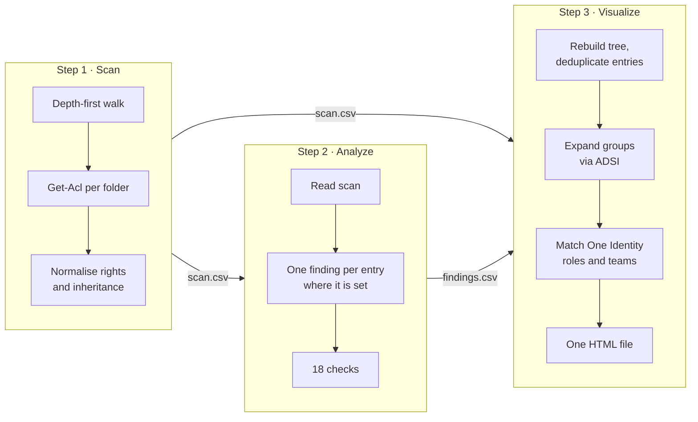
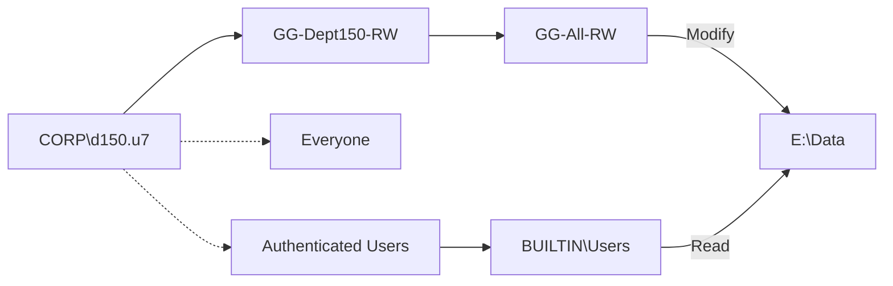

# How it works

This page explains what each script does internally, what data flows between them, and how the page computes access paths. For the list of checks, see [checks.md](checks.md). For the One Identity file formats, see [one-identity.md](one-identity.md).

## 1. Scan: Get-FolderPermissions.ps1

The script walks the tree depth-first with an explicit stack instead of recursion, so very deep trees can't overflow the call stack. Rows come out in tree order: a folder, then everything beneath it, then its next sibling. For each folder it reads the ACL with `Get-Acl` and writes one row per access entry.

| Column | Content |
|---|---|
| `FolderPath` | Full path of the folder |
| `Depth` | 0 for the scanned folder, 1 for its subfolders, and so on |
| `Owner` | Folder owner |
| `InheritanceDisabled` | True when inheritance is broken on this folder |
| `Identity` | The user, group or SID the entry applies to |
| `Rights` | FullControl, Modify, ReadAndExecute... |
| `AccessType` | Allow or Deny |
| `IsInherited` | True when inherited from a parent, False when set on this folder |
| `AppliesTo` | The wording of the Windows security dialog, for example "This folder, subfolders and files" |
| `UnresolvedSid` | True when the identity is a SID that no longer resolves |
| `Note` | Errors, empty or NULL DACLs, junctions |

Details:

- **Generic rights.** Entries such as CREATOR OWNER often come back as raw numbers like `268435456`. These are mapped to the equivalent file-system rights, so the report reads "FullControl" or "Modify". The `Synchronize` right is dropped as noise.
- **Coverage gaps are recorded.** A folder that can't be read still gets a row, with the error in `Note`. Gaps show up in the report instead of disappearing.
- **Junctions and symbolic links** are recorded but not followed, which avoids loops and double counting.
- **Options.** `-MaxDepth` limits how deep the scan goes. `-ExplicitOnly` keeps only explicit entries, which makes the output much smaller on large trees.
- **Encoding.** The CSV is UTF-8 with a byte-order mark, so Excel shows accented names correctly in both PowerShell 5.1 and 7.

## 2. Analyze: Find-PermissionIssues.ps1

The key design decision is **where** a finding is reported. An entry inherited by 5,000 folders is reported once:

- on the folder where it is explicit, or
- on the scanned top folder, when it comes from above the scan.

The `FoldersAffected` column counts the folders that inherit it. The report stays readable and each finding points to the one place where it has to be fixed.

**Account lookup.** Checks FP05 and FP14 need to know whether an identity is a user or a group. The script asks AD when a domain controller is reachable, and otherwise skips those two checks with a note. Broad, admin and well-known names are recognised in English, French and German.

**Outputs.** The script writes a findings CSV and a standalone HTML report sorted by severity. Each finding comes with a recommendation.

## 3. Visualize: New-PermissionGraph.ps1

### Folder tree and entry tables

The tree is rebuilt from the paths in the scan. Identities, rights and "applies to" values are stored once in lookup tables, and every access entry becomes a small tuple `[identity, rights, deny, applies to]`.

Most folders inherit exactly the same set of entries as their siblings. Each distinct inherited set is therefore stored once and shared. An 18,000-folder share, with group members, roles and teams, fits in about 1.2 MB of HTML.

### Group membership (`-IncludeGroupMembers`)

Membership is read with ADSI (`System.DirectoryServices`), which ships with Windows. The RSAT ActiveDirectory module is not needed.

1. **Resolve each identity** on the ACLs to a SID with Windows name translation. The SID is then looked up in AD: first with a `<SID=...>` bind in the current domain, then with an `objectSid` search on the global catalog for the other domains of the forest. Results are cached.
2. **Expand groups.**
   - **Ranged reads.** AD returns at most 1,500 values of `member` per read, so large groups are read with `member;range=` until complete.
   - **Primary-group members.** Accounts whose primary group is the group (Domain Users, Domain Computers...) are not listed in `member`. They are found with a `primaryGroupID` search.
   - **Nesting.** Nested groups are followed to any depth, and each group is read only once.
   - **Other domains.** Members from trusted domains (foreign security principals) are shown by name when Windows can translate their SID, otherwise as the SID. Their own group memberships are not read.
3. **Local groups.** BUILTIN\Administrators, BUILTIN\Users and other local groups are local to the file server, so they are read there through the WinNT provider. The server is taken from the UNC path, or from `-FileServer`.
4. **Well-known principals** such as Everyone, Authenticated Users, SYSTEM and CREATOR OWNER have no member list. The page explains what each one covers instead.
5. **Account properties.** For each account the script records whether it is disabled (`userAccountControl`), its type (user, computer, service account), and whether its distinguished name contains an `-ExternalOu` value.

At most `-MaxMembersPerGroup` members (default 5,000) are read per group. The page shows how many were not read.

### One Identity data

Role and team files are matched to groups and accounts by bare name, compared without regard to case. See [one-identity.md](one-identity.md). Only the roles and teams that relate to the scanned folders are embedded.

### The page

Everything is embedded in the HTML file as one compact JSON block, read by a single script. The page needs no CDN, fonts or network calls. All text is escaped for JavaScript and HTML, so a folder or group name can't break out of the page.

## How the page computes access

### Highlighting

When you pick an identity, group member, role, team or location, the page builds a map of **the identities on the ACLs that give access**, and colours every folder:

- **granted here** (dark blue): one of those identities has an entry on this folder;
- **inherited access** (light blue): the folder inherits such an entry from a parent;
- **deny** (dashed red outline): one of those identities has a Deny entry here.

Collapsed folders show how many folders with access are hidden beneath them. The paths to the first 400 folders with access are opened automatically.

### Access paths

For a principal (a person or a group), the identities that give access are:

1. the principal itself;
2. every group it is a member of, followed upwards through nesting;
3. for accounts, also Everyone and Authenticated Users.

Each highlighted folder says which identity the access comes through, for example "Modify via CORP\GG-All-RW".

- **A role's access** is the access of the groups it assigns, including the groups those groups are nested in.
- **A team's access** is the access of its people, excluding broad principals. See [one-identity.md](one-identity.md#how-team-access-is-computed).

### Group checks

- **Circular nesting** is found by computing the strongly connected components of the group graph, using Tarjan's algorithm in its iterative form. Every group in a component of more than one group is flagged.
- **Empty groups** are found by propagating "has content" upwards from every group that has an account, an unreadable membership, or members beyond the read limit. Groups never reached are empty, including groups that only contain other empty groups.
- **Broad groups.** A normal group that directly contains Everyone, Authenticated Users, Domain Users or a similar principal is a bad config. For team access, "broad" also propagates upwards: every group above such a group counts as everyone's access.

### Performance

The page draws only the folders and links inside the visible area. Below 42% zoom it switches to a lighter drawing without labels. Group statistics, member lists, team breakdowns and folder team lists are computed on first use and cached.

On a synthetic share of 18,201 folders with 6,000 users in 200 nested groups, 449 roles and 400 teams:

| Action | Time |
|---|---|
| Page load and first render | ~0.3 s |
| Select a group and open its 6,000-member graph | ~0.2 s |
| Select a team or location | ~0.15 s |

## Compatibility

- **PowerShell.** Windows PowerShell 5.1 and PowerShell 7. The graph script is saved as UTF-8 with a byte-order mark, so 5.1 reads its accented text correctly.
- **Windows language.** French and German group names are recognised as well as English.
- **Browser.** Any current browser: Edge, Chrome, Firefox or Safari. The page follows the system light or dark theme.
- **Input files.** CSV re-saved from Excel with `;` separators is accepted. The encoding is detected the same way in both scripts: a byte-order mark if there is one, otherwise UTF-8 if the file is valid UTF-8, otherwise the ANSI code page. Accented names survive an Excel re-save in PowerShell 5.1 and 7.
