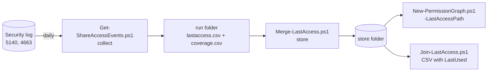
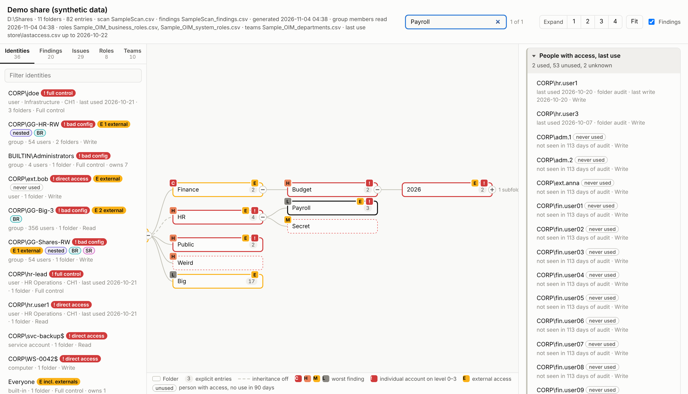

# Last use

The permission graph shows who **can** reach a folder. With a last-access store, the folder panel also shows when each of those people **last used** it. That way a reviewer can see which access is still needed and which access nobody has touched in 90 days.

Windows does not record "last access per person per folder", so this information is read from the Security log of the file servers and kept in a rolling store. Three scripts do the work, and the graph reads the store they write:



| Script | What it does |
|---|---|
| [`Get-ShareAccessEvents.ps1`](../scripts/Get-ShareAccessEvents.ps1) | Reads 5140 (Audit File Share) events, plus 4663 (Audit File System with a SACL) or 5145 where they are enabled. The source can be the live log, a Windows Event Forwarding collector, `.evtx` files, event XML or a SIEM CSV. Each run writes `lastaccess.csv` and `coverage.csv`. |
| [`Merge-LastAccess.ps1`](../scripts/Merge-LastAccess.ps1) | Folds runs into the store. It keeps the earliest first use and the latest last use per person and object, so a run merged twice changes nothing. It also joins the periods each log covered and applies retention (400 days by default). |
| [`Join-LastAccess.ps1`](../scripts/Join-LastAccess.ps1) | Adds `LastUsed`, `LastWrite`, `DaysSinceUse`, `Status` (Used, Unused or Unknown) and the evidence to any "who can reach which folder" CSV, for review in Excel. |

Folders are identified by the server's local path (`D:\Shares\Finance`), which is the same as `FolderPath` in a `Get-FolderPermissions.ps1` scan, so the store joins to the scan without any mapping.

## Setting up the audit

- **Every file server:** run `auditpol /set /subcategory:"File Share" /success:enable`, or set the same thing through a GPO. Windows then writes one 5140 event per SMB session and share. This is the default evidence and needs no SACL.
- **Sensitive folders only:** run `auditpol /set /subcategory:"File System" /success:enable` and add a SACL on the folder: Everyone, Success, "List folder / read data" and "Create files / write data", applied to this folder, subfolders and files. Pass these folders to `-AuditedFolder`. The 4663 events say which folder was used and whether anything was written, but they are noisy, so set them only where they are needed.
- **Log size:** make the Security log large enough to hold at least a day of events, or forward the events with WEF and read `ForwardedEvents`. The collector warns when the log no longer reaches back to the last run.

The account that runs the collector needs to be in **Event Log Readers** on the file server. For a remote log it also needs the "Remote Event Log Management" firewall rule.

## Daily run

```powershell
.\scripts\Get-ShareAccessEvents.ps1 -ComputerName FS01 -StorePath \\admin01\ivip\lastaccess `
    -FolderListPath .\FS01_scan.csv -AuditedFolder 'D:\Shares\HR' -OutputFolder .\run
.\scripts\Merge-LastAccess.ps1 -Path .\run -StorePath \\admin01\ivip\lastaccess
```

With `-StorePath`, the collector starts reading where the store ends, so a daily scheduled task reads each event once. When the page is built, point it at the store:

```powershell
.\scripts\New-PermissionGraph.ps1 -Path .\FS01_scan.csv -FindingsPath .\FS01_scan_findings.csv -IncludeGroupMembers `
    -FileServer FS01 -LastAccessPath \\admin01\ivip\lastaccess
```

## What the page shows



- **Folder panel:** the people who can reach the folder, with the last use of each one, the evidence (folder audit or share connection), the last write and their access. Used people come first. The summary line counts used, unused and unknown.
- **Identities, person card, member tooltip and team people:** the person's last use on these shares.
- **Unused** is a dotted grey chip, not a new colour. Red, yellow and violet keep their meaning. Computer and service accounts are never called unused.
- Last use is shown **per person**. A folder or share as a whole is never stamped "unused".

Which evidence counts for a folder:

1. If the folder is inside an audited folder (the scope of the 4663 coverage) and that audit covers `-UnusedDays`, the panel uses folder-level events at or below the folder.
2. Otherwise it uses share connections (5140) to the share that holds the folder. This is weaker evidence: it proves the person used the share, not this folder, and the panel says so.

Status, with `-UnusedDays` (default 90) counted back from the end of the coverage, not from today:

| Status | Meaning |
|---|---|
| **Used** | Seen in the last N days. |
| **Unused** | Not seen in the last N days, and the log was read without a gap for at least N days. |
| **Unknown** | Not seen, but the log covers less than N days, or no log covers this folder. Unknown never means unused. |

Without `-LastAccessPath`, the page is the same as before.

## Data layout

Every run folder and the store hold two CSV files: UTF-8 with BOM, quoted, comma separated (what `Export-Csv` writes). Any other source, such as a SIEM, can write the same layout and be merged without conversion.

### lastaccess.csv

One row per object and account.

| Column | Required | Meaning |
|---|---|---|
| Source | yes | `FileShare` |
| Origin | yes | The file server's short name (`FS01`). It is part of the key, so keep it stable. Use `-FileServer` on the graph and the join when the store holds several servers. |
| ObjectType | yes | `Share` (5140) or `Folder` (4663 / 5145) |
| ObjectId | yes | The local path on the server (`D:\Shares\Finance`), the same as `FolderPath` in a scan |
| ObjectName | | The share as users see it (`\\FS01\Finance`) |
| AccountKey | yes* | The account name without `DOMAIN\` and `@domain`, lower case. *If empty, it is made from Account. |
| Account | | The account as logged (`CORP\jdoe`) |
| AccountSid | | The SID from the event |
| AccountId, DisplayName | | Empty for file shares |
| FirstSeen | | First use |
| LastSeen | yes | Last use |
| LastWrite | | Last write, append or delete (4663 / 5145 only) |
| Events | | Number of events in the run. Informational only, the store does not keep it. |
| LastClient | | Client IP address of the last use |

Times are UTC in `yyyy-MM-ddTHH:mm:ssZ` format. Readers also accept an offset or fractions of a second.

### coverage.csv

The period each run actually read. Without it, the scripts can't tell a person who was not seen from a log that was not read, so they could say Used but never Unused.

| Column | Meaning |
|---|---|
| Source, Origin | As above |
| Feed | `5140`, `4663` or `5145` |
| Scope | `*` for every share on the server. For 4663 / 5145, one audited folder per row (`D:\Shares\HR`). |
| From, To | The period read, in UTC. A run that stopped early writes only the part it read. |
| Events | Events read (informational) |
| Collected | When the run happened |

### The store

The store folder holds:

- **`lastaccess.csv`**: the columns above without Events, plus `Updated`. The key is Source, Origin, ObjectType, ObjectId and AccountKey, compared without regard to case.
- **`coverage.csv`**: Source, Origin, Feed, Scope, From, To and Collected. Periods of the same feed and scope that overlap or lie less than 60 minutes apart are joined. Gaps are kept and reported.
- **`*.bak`**: the previous version of both files.

The merge rules are:

- **Dates:** FirstSeen is the earliest, and LastSeen and LastWrite are the latest. The names and LastClient come from the row with the latest LastSeen.
- **Idempotent:** the merge only takes minimums and maximums, so merging the same run twice, or two overlapping runs, gives the same store.
- **Retention:** `-RetentionDays` (default 400) removes rows last seen before that date, and coverage is cut to the same period. A removed row is therefore never read as "never used".

## Sample

`dev/Test-Sample.ps1` builds everything in [samples/lastaccess](../samples/lastaccess) without a file server. It covers server FS01, the accounts of the demo directory, and the folders of `samples/SampleScan.csv`. Every name, SID and address in it is made up. The steps are:

1. `dev/New-SampleLogs.ps1` writes synthetic Security log exports (event XML, not committed) and the folder access list `FS01_who_can_access.csv`.
2. `Get-ShareAccessEvents.ps1` reads them in two runs: `runs/fs01-2026q3` covers 2026-07-01 to 2026-10-01 with HR audited, and `runs/fs01-2026-10` covers up to 2026-10-22 with HR and Finance\Budget audited.
3. `Merge-LastAccess.ps1` folds the runs into `store/`, then merges everything again to check that the store does not change.
4. `Join-LastAccess.ps1` writes `FS01_who_can_access_lastused.csv`: 401 rows, 160 used and 241 unused.

The [demo page](demo/index.html) was built with `-LastAccessPath samples/lastaccess/store -FileServer FS01`.

## Security

The collector output, the store and the page name people and the folders they used. Store and share them like any other access review evidence. The `.gitignore` also blocks `.evtx` and `.xml` files, so a Security log export is not committed by accident.
